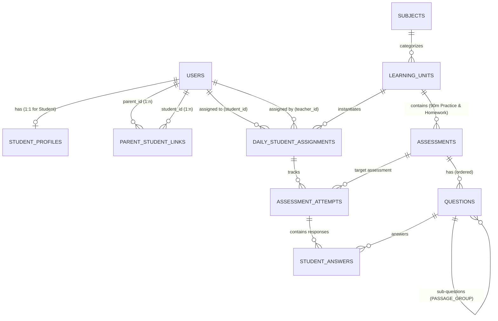
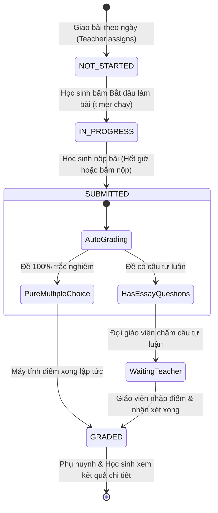

# Database Schema Specification (`database_schema.md`)

## 1. Kiến trúc & Quyết định Thiết kế (Architecture & Design Decisions)
- **Hệ quản trị CSDL mục tiêu:** PostgreSQL 15+ (tương thích hoàn hảo với Supabase Postgres).
- **Khóa chính (Primary Keys):** `UUID` (`gen_random_uuid()`) đảm bảo an toàn, không lộ số lượng học sinh hay thứ tự bài học, đồng bộ tốt với Supabase Auth.
- **Đa hình nội dung môn học qua JSONB (Multi-Subject Polymorphism):** 
  - Thay vì tạo hàng chục bảng cho từng dạng câu hỏi (trắc nghiệm, điền từ, đọc hiểu tiếng Anh, công thức Toán LaTeX, chụp ảnh bài làm), hệ thống sử dụng cấu trúc `JSONB` chuẩn hóa cho `question_payload`, `grading_key_payload` và `answer_payload`.
  - Giữ schema tinh gọn (10 bảng cốt lõi) nhưng hỗ trợ từ học sinh lớp 2 đến luyện thi lớp 12.
- **Tách biệt Kho học liệu & Lần giao bài thực tế (Template vs. Instance Separation):**
  - **Kho học liệu tĩnh (`learning_units`, `assessments`, `questions`):** Tạo một lần, tái sử dụng cho nhiều học sinh ở cùng khối lớp qua các năm.
  - **Lộ trình cá nhân hóa hàng ngày (`daily_student_assignments`, `assessment_attempts`, `student_answers`):** Khởi tạo riêng biệt cho từng học sinh vào mỗi buổi học, theo dõi độc lập tiến độ, thời gian và điểm số.
- **Bảo mật & Phân quyền Phụ huynh (Parent Read-Only Guarantee):**
  - Cấu trúc ràng buộc thông qua bảng liên kết `parent_student_links`.
  - Phụ huynh có thể xem toàn bộ bài giảng, đề bài, bài làm và nhận xét của con, nhưng bị khóa hoàn toàn quyền chỉnh sửa/nộp bài ở tầng Database thông qua Row Level Security (RLS).

---

## 2. Sơ đồ Quan hệ Thực thể (Entity Relationship Diagram)



---

## 3. Từ điển Dữ liệu Chi tiết (Data Dictionary)

### 3.1. Phân hệ Tài khoản & Phân quyền (Auth & Profiles)

#### Bảng `users`
Bảng tài khoản trung tâm của hệ thống (đồng bộ với Supabase Auth nếu cần).
| Cột | Kiểu | Ràng buộc | Mô tả |
| :--- | :--- | :--- | :--- |
| `id` | `UUID` | PK, default `gen_random_uuid()` | Định danh người dùng |
| `username` | `VARCHAR(100)` | UNIQUE, NOT NULL | Tên đăng nhập (phù hợp cho học sinh nhỏ tuổi) |
| `email` | `VARCHAR(255)` | UNIQUE, NULLABLE | Email (học sinh lớp 2 có thể để NULL) |
| `password_hash` | `TEXT` | NOT NULL | Mật khẩu băm (Argon2 / Bcrypt) |
| `full_name` | `VARCHAR(150)` | NOT NULL | Họ và tên hiển thị |
| `role` | `user_role` | NOT NULL | Enum: `'TEACHER'`, `'STUDENT'`, `'PARENT'` |
| `is_active` | `BOOLEAN` | NOT NULL, DEFAULT TRUE | Trạng thái hoạt động |
| `created_at` / `updated_at` | `TIMESTAMPTZ` | NOT NULL, DEFAULT NOW() | Thời gian tạo / cập nhật |

#### Bảng `student_profiles`
Hồ sơ mở rộng 1-1 cho tài khoản có role `STUDENT`.
| Cột | Kiểu | Ràng buộc | Mô tả |
| :--- | :--- | :--- | :--- |
| `user_id` | `UUID` | PK, FK -> `users(id)` ON DELETE CASCADE | ID học sinh |
| `grade_level` | `SMALLINT` | CHECK (1..12), NOT NULL | Khối lớp (2, 7, 9, 11, 12, ...) |
| `ui_theme` | `ui_mode` | NOT NULL, DEFAULT `'STANDARD_SECONDARY'` | Theme giao diện (`'KIDS_ELEMENTARY'`, `'STANDARD_SECONDARY'`, `'HIGH_SCHOOL_EXAM'`) |
| `default_session_minutes` | `INT` | NOT NULL, DEFAULT 90 | Thời lượng buổi học mặc định (phút) |
| `tutor_private_notes` | `TEXT` | NULLABLE | Ghi chú riêng của gia sư (chỉ giáo viên thấy) |
| `updated_at` | `TIMESTAMPTZ` | NOT NULL, DEFAULT NOW() | Thời gian cập nhật |

#### Bảng `parent_student_links`
Xác lập mối quan hệ giữa Phụ huynh và Học sinh.
| Cột | Kiểu | Ràng buộc | Mô tả |
| :--- | :--- | :--- | :--- |
| `parent_id` | `UUID` | PK, FK -> `users(id)` ON DELETE CASCADE | ID phụ huynh |
| `student_id` | `UUID` | PK, FK -> `users(id)` ON DELETE CASCADE | ID học sinh |
| `relationship` | `VARCHAR(50)` | DEFAULT `'Parent'` | Mối quan hệ: Bố, Mẹ, Giám hộ |
| `created_at` | `TIMESTAMPTZ` | NOT NULL, DEFAULT NOW() | Thời gian liên kết |

---

### 3.2. Phân hệ Kho Học liệu (Curriculum & Learning Content)

#### Bảng `subjects`
| Cột | Kiểu | Ràng buộc | Mô tả |
| :--- | :--- | :--- | :--- |
| `id` | `UUID` | PK, default `gen_random_uuid()` | Định danh môn học |
| `code` | `VARCHAR(50)` | UNIQUE, NOT NULL | Mã môn: `'ENG_12'`, `'MATH_7'`, `'CHEM_9'`, `'MATH_2'` |
| `name` | `VARCHAR(150)` | NOT NULL | Tên môn: Tiếng Anh 12, Toán 7, Hóa 9... |
| `target_grade` | `SMALLINT` | NOT NULL | Khối lớp mục tiêu |
| `enable_latex` | `BOOLEAN` | NOT NULL, DEFAULT FALSE | Cho phép bật bộ gõ KaTeX/LaTeX trên giao diện |

#### Bảng `learning_units` (Đơn vị bài học hàng ngày)
| Cột | Kiểu | Ràng buộc | Mô tả |
| :--- | :--- | :--- | :--- |
| `id` | `UUID` | PK, default `gen_random_uuid()` | Định danh bài học |
| `subject_id` | `UUID` | FK -> `subjects(id)` RESTRICT | Môn học |
| `created_by` | `UUID` | FK -> `users(id)` | Giáo viên biên soạn |
| `title` | `VARCHAR(255)` | NOT NULL | Tiêu đề bài học |
| `description` | `TEXT` | NULLABLE | Tóm tắt nội dung |
| `lecture_content_markdown` | `TEXT` | NULLABLE | Nội dung lý thuyết (Markdown + LaTeX) |
| `lecture_attachments` | `JSONB` | NOT NULL, DEFAULT `'[]'` | Danh sách file đính kèm (PDF, slides, audio) |
| `is_template` | `BOOLEAN` | NOT NULL, DEFAULT TRUE | Có phải bài học mẫu để nhân bản không |

#### Bảng `assessments` (Bộ đề bài tập)
Mỗi `learning_unit` sẽ chứa 2 bài: 1 bài tập trong buổi 90 phút (`IN_SESSION_90M`) và 1 bài tập về nhà (`HOMEWORK`).
| Cột | Kiểu | Ràng buộc | Mô tả |
| :--- | :--- | :--- | :--- |
| `id` | `UUID` | PK, default `gen_random_uuid()` | Định danh đề |
| `learning_unit_id` | `UUID` | FK -> `learning_units(id)` CASCADE | Thuộc bài học nào |
| `type` | `assessment_type` | NOT NULL | `'IN_SESSION_90M'` hoặc `'HOMEWORK'` |
| `title` | `VARCHAR(255)` | NOT NULL | Tên đề bài tập |
| `instructions` | `TEXT` | NULLABLE | Hướng dẫn làm bài |
| `time_limit_minutes` | `INT` | NULLABLE | Thời gian làm bài (90p cho in-session, NULL cho BTVN) |
| `max_score` | `NUMERIC(5,2)` | NOT NULL, DEFAULT 10.00 | Thang điểm tối đa (thường là 10.00) |

#### Bảng `questions` (Câu hỏi trong đề)
| Cột | Kiểu | Ràng buộc | Mô tả |
| :--- | :--- | :--- | :--- |
| `id` | `UUID` | PK, default `gen_random_uuid()` | Định danh câu hỏi |
| `assessment_id` | `UUID` | FK -> `assessments(id)` CASCADE | Đề bài chứa câu hỏi |
| `parent_question_id` | `UUID` | FK -> `questions(id)` CASCADE, NULLABLE | Dùng cho đoạn văn/file nghe nhóm nhiều câu hỏi con |
| `order_index` | `INT` | NOT NULL, DEFAULT 0 | Thứ tự hiển thị trong bài |
| `type` | `question_type` | NOT NULL | `'MULTIPLE_CHOICE'`, `'FILL_IN_BLANK'`, `'PASSAGE_GROUP'`, `'ESSAY_UPLOAD'` |
| `points` | `NUMERIC(5,2)` | NOT NULL, DEFAULT 1.00 | Trọng số điểm câu hỏi |
| `question_payload` | `JSONB` | NOT NULL | Nội dung câu hỏi (xem mục 4) |
| `grading_key_payload` | `JSONB` | NOT NULL, DEFAULT `'{}'` | Đáp án đúng & Lời giải (xem mục 4) |

---

### 3.3. Phân hệ Giao bài, Làm bài & Chấm bài (Daily Execution & Grading)

#### Bảng `daily_student_assignments` (Lịch giao bài theo ngày)
| Cột | Kiểu | Ràng buộc | Mô tả |
| :--- | :--- | :--- | :--- |
| `id` | `UUID` | PK, default `gen_random_uuid()` | ID phiên giao bài |
| `student_id` | `UUID` | FK -> `users(id)` CASCADE | Học sinh nhận bài |
| `learning_unit_id` | `UUID` | FK -> `learning_units(id)` RESTRICT | Bài học được giao |
| `assigned_by` | `UUID` | FK -> `users(id)` | Giáo viên giao |
| `assigned_date` | `DATE` | NOT NULL | Ngày học sinh cần làm (VD: `2026-10-28`) |
| `custom_session_minutes` | `INT` | DEFAULT 90 | Thời lượng làm bài trên lớp được điều chỉnh |
| `homework_due_at` | `TIMESTAMPTZ` | NULLABLE | Deadline nộp BTVN |
| `lecture_viewed_at` | `TIMESTAMPTZ` | NULLABLE | Thời điểm học sinh bấm xem bài giảng |
| `teacher_daily_note` | `TEXT` | NULLABLE | Lời dặn dò buổi học (Phụ huynh có thể xem) |
| `is_published` | `BOOLEAN` | NOT NULL, DEFAULT TRUE | Học sinh đã thấy bài giao chưa |
| **Constraint** | `UNIQUE` | `(student_id, learning_unit_id, assigned_date)` | Mỗi học sinh chỉ nhận 1 unit/ngày |

#### Bảng `assessment_attempts` (Lượt làm bài)
| Cột | Kiểu | Ràng buộc | Mô tả |
| :--- | :--- | :--- | :--- |
| `id` | `UUID` | PK, default `gen_random_uuid()` | ID lượt làm bài |
| `daily_assignment_id` | `UUID` | FK -> `daily_student_assignments(id)` CASCADE | Thuộc buổi học nào |
| `assessment_id` | `UUID` | FK -> `assessments(id)` RESTRICT | Thuộc đề nào (90p hoặc BTVN) |
| `student_id` | `UUID` | FK -> `users(id)` CASCADE | Học sinh thực hiện |
| `status` | `attempt_status` | DEFAULT `'NOT_STARTED'` | `'NOT_STARTED'`, `'IN_PROGRESS'`, `'SUBMITTED'`, `'GRADED'` |
| `started_at` | `TIMESTAMPTZ` | NULLABLE | Thời điểm bắt đầu bấm làm bài |
| `submitted_at` | `TIMESTAMPTZ` | NULLABLE | Thời điểm nộp bài |
| `time_spent_seconds` | `INT` | NOT NULL, DEFAULT 0 | Tổng thời gian làm bài thực tế (giây) |
| `is_overtime` | `BOOLEAN` | NOT NULL, DEFAULT FALSE | Có làm quá giờ cho phép không |
| `auto_score` | `NUMERIC(5,2)` | DEFAULT 0 | Điểm trắc nghiệm máy tự chấm |
| `manual_score` | `NUMERIC(5,2)` | DEFAULT 0 | Điểm tự luận giáo viên chấm |
| `total_score` | `NUMERIC(5,2)` | DEFAULT 0 | Tổng điểm cuối cùng (`auto_score + manual_score`) |
| `overall_feedback` | `TEXT` | NULLABLE | Lời phê tổng quan của giáo viên |
| `graded_by` | `UUID` | FK -> `users(id)`, NULLABLE | Giáo viên chấm bài |
| `graded_at` | `TIMESTAMPTZ` | NULLABLE | Thời điểm chấm xong |
| **Constraint** | `UNIQUE` | `(daily_assignment_id, assessment_id)` | Mỗi đề chỉ làm 1 lần theo bài giao |

#### Bảng `student_answers` (Chi tiết câu trả lời)
| Cột | Kiểu | Ràng buộc | Mô tả |
| :--- | :--- | :--- | :--- |
| `id` | `UUID` | PK, default `gen_random_uuid()` | ID câu trả lời |
| `attempt_id` | `UUID` | FK -> `assessment_attempts(id)` CASCADE | Thuộc lượt nộp bài nào |
| `question_id` | `UUID` | FK -> `questions(id)` RESTRICT | Trả lời cho câu hỏi nào |
| `answer_payload` | `JSONB` | NOT NULL, DEFAULT `'{}'` | Dữ liệu trả lời (text, lựa chọn, ảnh chụp vở...) |
| `is_correct` | `BOOLEAN` | NULLABLE | Đúng/Sai (NULL nếu là tự luận chờ chấm) |
| `awarded_points` | `NUMERIC(5,2)` | DEFAULT 0 | Điểm đạt được cho câu này |
| `teacher_comment` | `TEXT` | NULLABLE | Lời phê riêng cho câu này |
| `annotated_image_url`| `TEXT` | NULLABLE | URL ảnh bài làm đã được giáo viên khoanh đỏ/chấm chữa |
| **Constraint** | `UNIQUE` | `(attempt_id, question_id)` | Mỗi câu chỉ có 1 câu trả lời trong 1 attempt |

---

## 4. Chuẩn Hóa Cấu Trúc JSONB (Payload Schemas)

Hệ thống sử dụng các hợp đồng dữ liệu JSONB sau để giao tiếp giữa Frontend và Database:

### 4.1. Câu hỏi Trắc nghiệm (`MULTIPLE_CHOICE`)
```json
// question_payload
{
  "content_markdown": "Tính tích phân $\\int_{0}^{1} 2x dx$:",
  "media_url": null,
  "options": [
    { "id": "A", "text": "0" },
    { "id": "B", "text": "1" },
    { "id": "C", "text": "2" },
    { "id": "D", "text": "3" }
  ],
  "shuffle_options": false
}

// grading_key_payload (Chỉ giáo viên thấy trước khi chấm)
{
  "correct_option_id": "B",
  "explanation_markdown": "Ta có $\\int_{0}^{1} 2x dx = [x^2]_{0}^{1} = 1 - 0 = 1$."
}

// answer_payload (Học sinh nộp)
{
  "selected_option_id": "B"
}
```

### 4.2. Câu hỏi Tự luận / Chụp ảnh vở nộp bài (`ESSAY_UPLOAD`)
```json
// question_payload
{
  "prompt_markdown": "Giải phương trình hóa học sau và tính khối lượng kết tủa:\n$$\\text{Ba(OH)}_2 + \\text{H}_2\\text{SO}_4 \\rightarrow \\text{BaSO}_4\\downarrow + 2\\text{H}_2\\text{O}$$",
  "guidelines": "Học sinh làm bài ra vở, chụp ảnh rõ nét và tải lên.",
  "allow_latex_input": true,
  "allow_file_upload": true,
  "max_images": 5
}

// grading_key_payload
{
  "rubric": [
    { "criteria": "Viết đúng phương trình hóa học", "max_points": 0.5 },
    { "criteria": "Tính đúng số mol BaSO4", "max_points": 1.0 },
    { "criteria": "Tính đúng khối lượng kết tủa", "max_points": 0.5 }
  ],
  "sample_solution_markdown": "Số mol kết tủa tính theo..."
}

// answer_payload (Học sinh nộp: có thể gõ text, latex và đính kèm ảnh vở chụp)
{
  "text_response": "Em đã làm bài chi tiết trong vở ạ.",
  "latex_code": null,
  "image_urls": [
    "https://your-supabase.supabase.co/storage/v1/object/public/submissions/std_01/bai_toan_p1.webp",
    "https://your-supabase.supabase.co/storage/v1/object/public/submissions/std_01/bai_toan_p2.webp"
  ]
}
```

### 4.3. Câu hỏi Đoạn văn / Nghe hiểu (`PASSAGE_GROUP`)
```json
// Câu hỏi cha (parent_question_id = NULL)
// question_payload
{
  "passage_markdown": "Read the following passage and mark the letter A, B, C, or D...",
  "audio_url": "https://.../listening_unit_01.mp3",
  "passage_title": "The Impact of Artificial Intelligence"
}
// Các câu hỏi con sẽ tham chiếu parent_question_id đến ID câu hỏi cha này.
```

---

## 5. Vòng đời Trạng thái Bài tập (Lifecycle & State Machine)



---

## 6. Chính sách Bảo mật Dữ liệu (Row Level Security - RLS)

Khi sử dụng PostgreSQL trên Supabase, kích hoạt RLS trên các bảng để bảo vệ dữ liệu ở tầng CSDL:

1. **Quyền của TEACHER:**
   * Có toàn quyền `SELECT, INSERT, UPDATE, DELETE` trên toàn bộ bảng.
2. **Quyền của STUDENT:**
   * `SELECT`: Chỉ đọc các `daily_student_assignments`, `assessment_attempts`, `student_answers` có `student_id = auth.uid()`.
   * `INSERT / UPDATE`: Chỉ được thêm/sửa câu trả lời vào `student_answers` và cập nhật `assessment_attempts` khi trạng thái là `'IN_PROGRESS'`. Tuyệt đối không được sửa điểm (`awarded_points`, `total_score`).
3. **Quyền của PARENT (Chỉ đọc - Read Only):**
   * `SELECT`: Được phép đọc bài giảng, điểm số, bài làm của con:
     ```sql
     -- Policy đọc cho Parent
     CREATE POLICY "Parents view children attempts"
     ON assessment_attempts FOR SELECT
     TO authenticated
     USING (
         student_id IN (
             SELECT student_id FROM parent_student_links 
             WHERE parent_id = auth.uid()
         )
     );
     ```
   * `INSERT / UPDATE / DELETE`: **BỊ CHẶN 100%**. Không có bất kỳ policy ghi nào cho Role `PARENT`.

---

## 7. Chiến lược Tối ưu Dung lượng & Hiệu năng cho Gói Miễn Phí (Free Tier)

- **Supabase Free Storage (Giới hạn 1GB):**
  - **Nén ảnh trước khi tải lên (Client-side Compression):** Frontend sử dụng thư viện `browser-image-compression` để chuyển ảnh camera từ 4MB-8MB thành file định dạng `.webp` kích thước ~200KB - 300KB trước khi gọi Supabase Storage API. Giúp 1GB lưu trữ được hơn 3,000 - 4,000 bài làm.
- **Indexes trọng yếu:**
  - `idx_daily_assignments_student_date`: Giúp trang chủ học sinh tải lộ trình hôm nay trong vài mili-giây.
  - `idx_questions_assessment`: Tải toàn bộ câu hỏi của đề bài theo thứ tự `order_index`.
  - `idx_assessment_attempts_student_status`: Giúp giáo viên lọc nhanh danh sách các bài đang chờ chấm (`SUBMITTED`).
